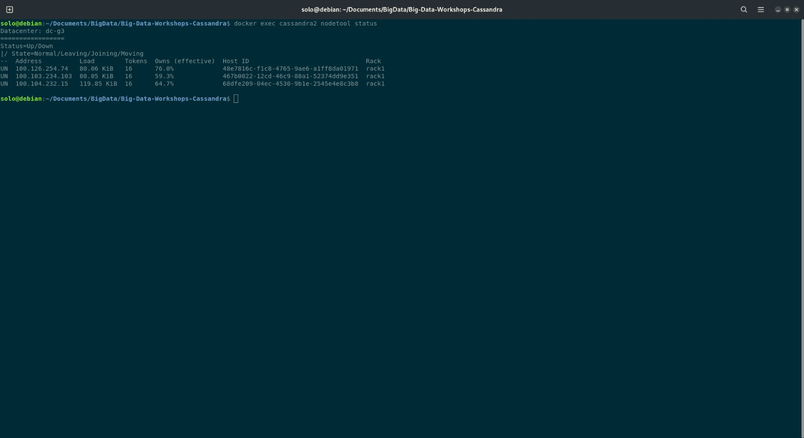
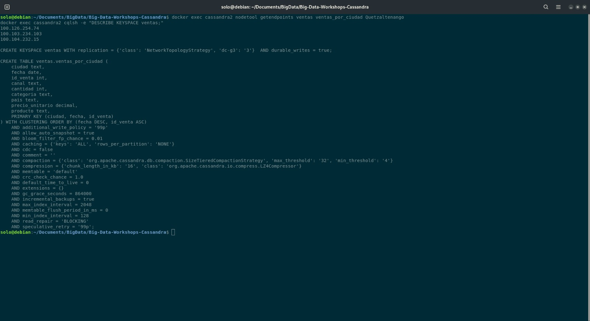
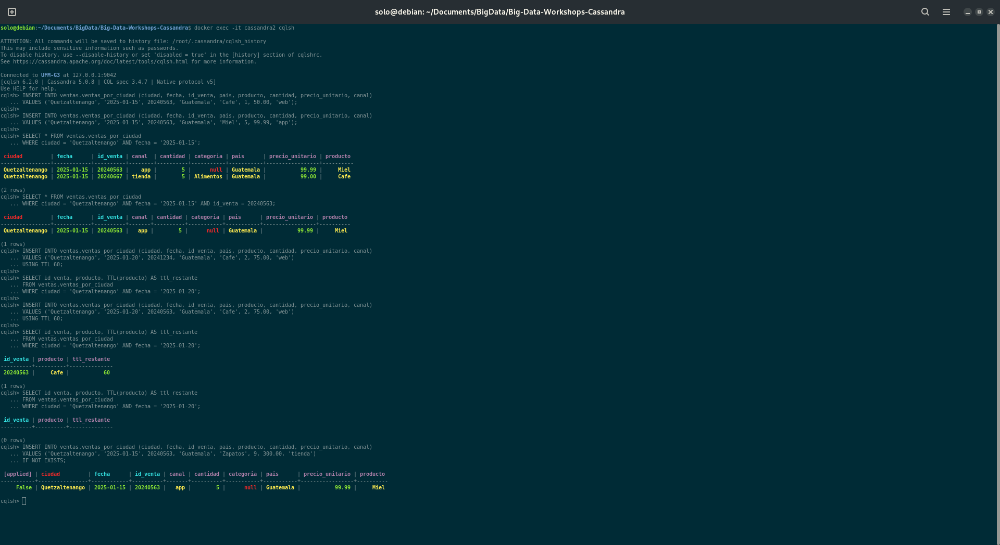
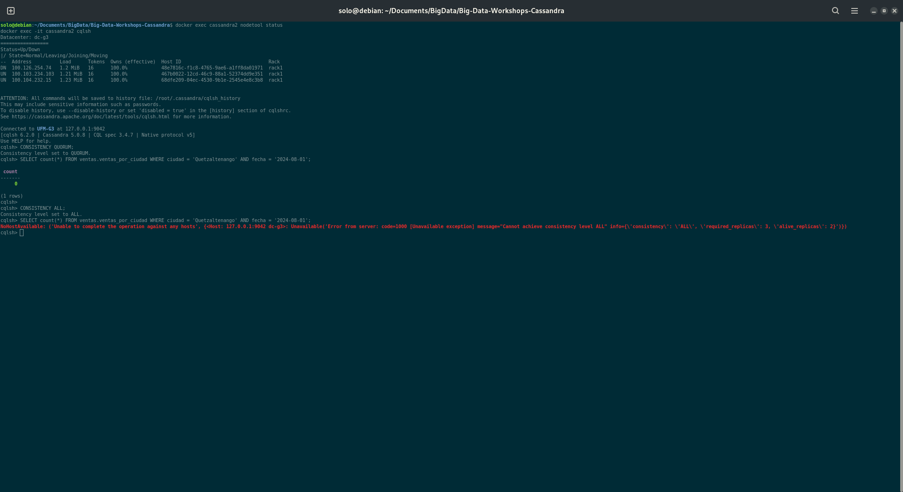
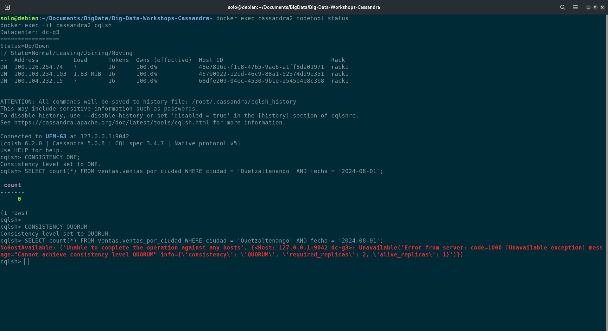
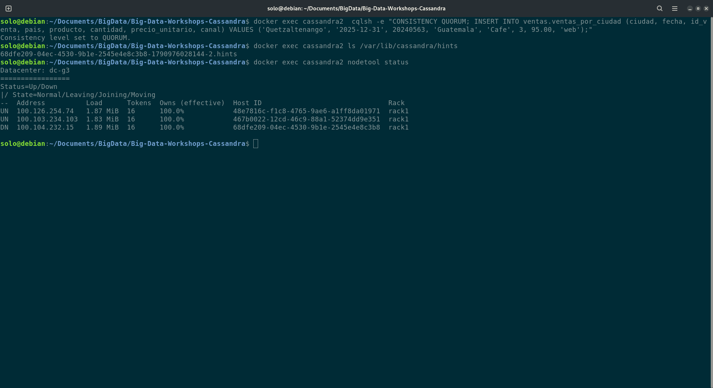
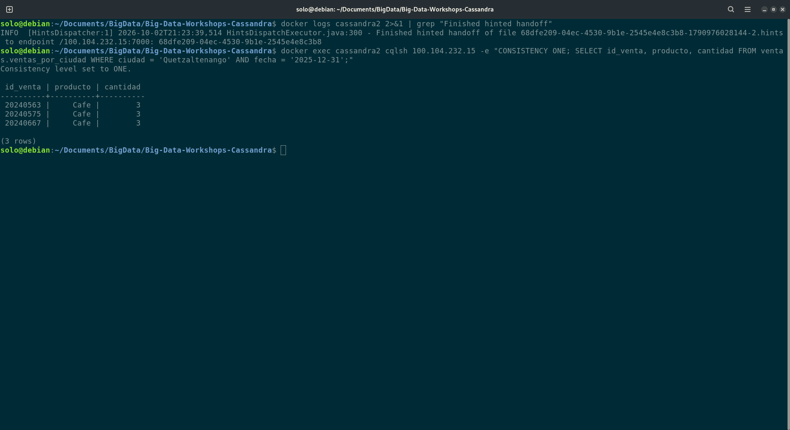

# Bitácora del taller de Cassandra

- **Nombre:** Juan Ochaita
- **Carné:** 20240563
- **Grupo:** G3
- **Tu nodo en el clúster del grupo:** cassandra2

---

## 1. Evidencias

### E1. Tres nodos en tu clúster y tu datacenter

`nodetool status` muestra los tres nodos del datacenter `dc-g3` en estado `UN` (Up/Normal), con 16 tokens cada uno.

### E2. Las copias de la partición de Quetzaltenango

`nodetool getendpoints` devuelve las tres IP del clúster como réplicas de la partición `Quetzaltenango`. Esto es consistente con el keyspace `ventas`, que usa `NetworkTopologyStrategy` con `'dc-g3': 3`.

### E3. Upsert, TTL e IF NOT EXISTS

- **Upsert:** el segundo INSERT con la misma llave (`20240563`) sobrescribió la fila. Ahora muestra `Miel`, cantidad 5 y canal `app`, sin crear una fila nueva.
- **TTL:** la fila con `USING TTL 60` mostró `ttl_restante = 60` y, pasado el tiempo, el SELECT devolvió 0 filas porque expiró.
- **IF NOT EXISTS:** el INSERT sobre una llave existente devolvió `[applied] = False` junto con la fila ya guardada, y no la modificó.

### E4. Un nodo caído: QUORUM frente a ALL

Con un nodo en `DN`, la lectura con `QUORUM` respondió (`count = 0`). Con `ALL` falló con `Unavailable`: requería 3 réplicas y solo había 2 vivas.

### E5. Dos nodos caídos: ONE frente a QUORUM

Con dos nodos en `DN`, `ONE` respondió (`count = 0`). `QUORUM` falló con `Unavailable`: requería 2 réplicas y solo había 1 viva.

### E6a. El hint guardado para el nodo caído

Con el nodo `68dfe209…` caído, el INSERT con `QUORUM` tuvo éxito. En `/var/lib/cassandra/hints` apareció un archivo `.hints` con el Host ID del nodo caído, que es el hint pendiente de entrega.

### E6b. La entrega del hint

El log muestra `Finished hinted handoff` hacia `100.104.232.15`. Al consultar ese nodo con `ONE`, ya devuelve la venta `20240563` de `2025-12-31`.

### Tabla del Paso 8

| Nodos caídos | `ONE` | `QUORUM` | `ALL` |
|---|---|---|---|
| 0 | ✅ | ✅ | ✅ |
| 1 | ✅ | ✅ | ❌ |
| 2 | ✅ | ❌ | ❌ |
---

## 2. Preguntas

**1. ¿Qué línea de la traza muestra que la consulta por ciudad leyó una sola partición, y cuál que la de producto recorrió toda la tabla? ¿Por qué Cassandra rechaza la segunda sin ALLOW FILTERING?**

En la traza de la consulta por ciudad aparece la línea `Executing single-partition query on ventas_por_ciudad`, porque la partition key (`ciudad`) permite ir directo a las réplicas de esa partición. En la consulta por producto la traza muestra una lectura por rangos, con líneas como `Computing ranges to query` y `Submitting range requests on N ranges`, es decir, un recorrido de todos los rangos de token de la tabla. Cassandra la rechaza sin `ALLOW FILTERING` porque `producto` no es parte de la llave: tendría que leer todas las particiones de todos los nodos y filtrar después. Ese costo crece con el tamaño de los datos y es impredecible, así que exige que el usuario lo pida de forma explícita.

**2. ¿Qué lecturas se comportaron como CP y cuáles como AP? ¿Qué nivel usarías para el saldo de una cuenta y cuál para un contador de reproducciones, y por qué?**

`ALL` (con 1 nodo caído) y `QUORUM` (con 2 nodos caídos) se comportaron como CP. Prefirieron rechazar la lectura con `Unavailable` antes que responder sin la garantía de consistencia. `ONE` se comportó como AP: respondió siempre, incluso con dos nodos caídos, aunque podría devolver un dato desactualizado. `QUORUM` con un nodo caído sigue funcionando porque basta con la mayoría (2 de 3).

**3. ¿Cómo se enteró el nodo apagado de tu venta? ¿Qué pasaría si el nodo estuviera apagado más tiempo que max_hint_window?**

El coordinador detectó que la réplica estaba caída, escribió la venta en las otras dos y guardó un hint (archivo en `/var/lib/cassandra/hints`). Cuando el nodo volvió y Gossip lo marcó como `UN`, el coordinador le entregó el hint (`Finished hinted handoff`) y el nodo aplicó la venta. Si el nodo estuviera apagado más tiempo que `max_hint_window` (3 horas por defecto), el coordinador dejaría de guardar hints para él, y las escrituras de ese lapso no se le entregarían automáticamente. Habría que ejecutar `nodetool repair` para sincronizarlo, aunque el read repair también corregiría parte de los datos al leerlos.

---
## 3. Mini-reto

### Tablas

| Tabla | Consulta que responde | Partition key | Clustering key |
|---|---|---|---|
| usuarios_por_id | C1 | usuario_id | (ninguna) |
| mensajes_por_canal | C2 | canal_id | enviado_en DESC, mensaje_id DESC |
| mensajes_por_usuario | C3 | usuario_id | enviado_en DESC, mensaje_id DESC |
| mensajes_por_canal_dia | C4 | (canal_id, dia) | mensaje_id |

### Justificación

**Por qué esas llaves:**

- `usuarios_por_id`: C1 busca un usuario por su id, así que `usuario_id` como partition key lleva a una sola partición con una sola fila. No hace falta clustering key.
- `mensajes_por_canal`: C2 filtra por `canal_id`, por lo que lee una sola partición. El clustering `enviado_en DESC` deja los mensajes ya ordenados del más reciente al más antiguo, y `LIMIT 20` lee solo las primeras 20 filas sin ordenar nada al consultar. `mensaje_id` va al final para que dos mensajes con el mismo instante no se sobrescriban.
- `mensajes_por_usuario`: misma idea para C3, con `usuario_id` como partition key. Sus mensajes de todos los canales quedan juntos y ordenados por fecha descendente; `LIMIT 10` toma los 10 más recientes.
- `mensajes_por_canal_dia`: C4 cuenta los mensajes de un canal en un día. Con `(canal_id, dia)` como partition key, cada día de cada canal es una partición pequeña y acotada, y el `COUNT(*)` lee solo esa partición con igualdad exacta, sin ALLOW FILTERING. `mensaje_id` como clustering hace que cada mensaje sea una fila distinta. El día se calcula en UTC, igual que los CSV.

**Qué datos quedaron duplicados entre tablas:**

- `nombre_usuario` está en `usuarios_por_id` y en cada fila de `mensajes_por_canal`.
- El nombre del servidor y el del canal están copiados en cada fila de `mensajes_por_usuario`.
- `contenido`, `enviado_en`, `mensaje_id`, `usuario_id` y `canal_id` de cada mensaje se repiten en las tablas de mensajes, y `mensaje_id` también en `mensajes_por_canal_dia`.

**Qué hace la aplicación si cambia un dato duplicado:**

Cassandra no mantiene la consistencia entre tablas, así que la aplicación debe escribir el cambio en todas las tablas que contienen el dato (idealmente con un `BATCH` o con reintentos). Si un usuario cambia su `nombre_usuario`, actualiza `usuarios_por_id` y, usando `mensajes_por_usuario` para localizar sus mensajes (`canal_id`, `enviado_en`, `mensaje_id`), actualiza `nombre_usuario` en cada fila de `mensajes_por_canal`. Si cambia el nombre de un canal o de un servidor, recorre los mensajes afectados y actualiza `mensajes_por_usuario`. Si se edita o borra un mensaje, se modifica o elimina en las tres tablas de mensajes. Estos cambios son poco frecuentes frente a las lecturas, por eso se acepta el costo de duplicar.
